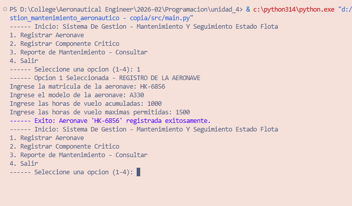
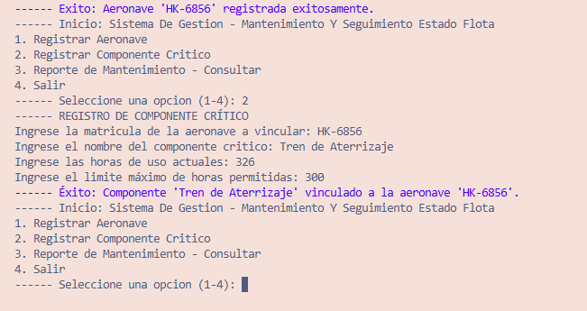
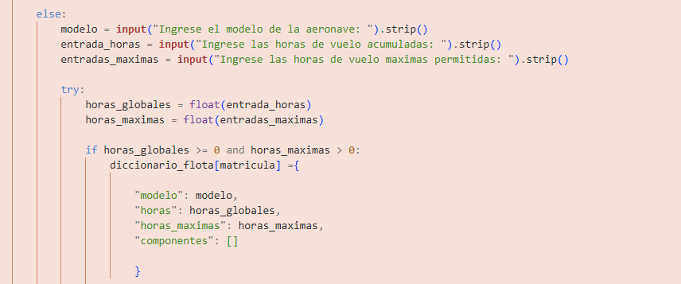
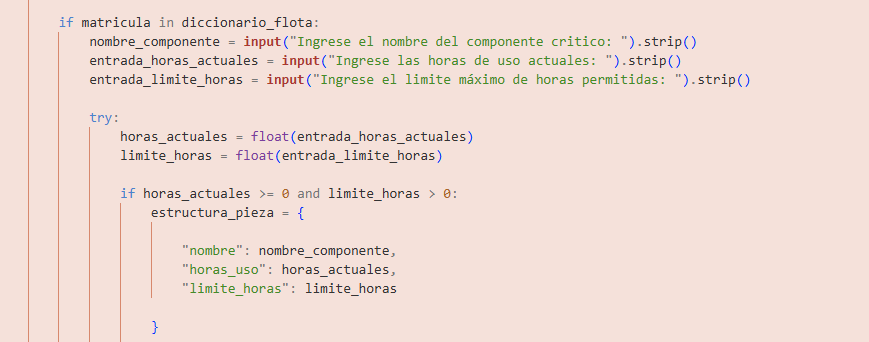
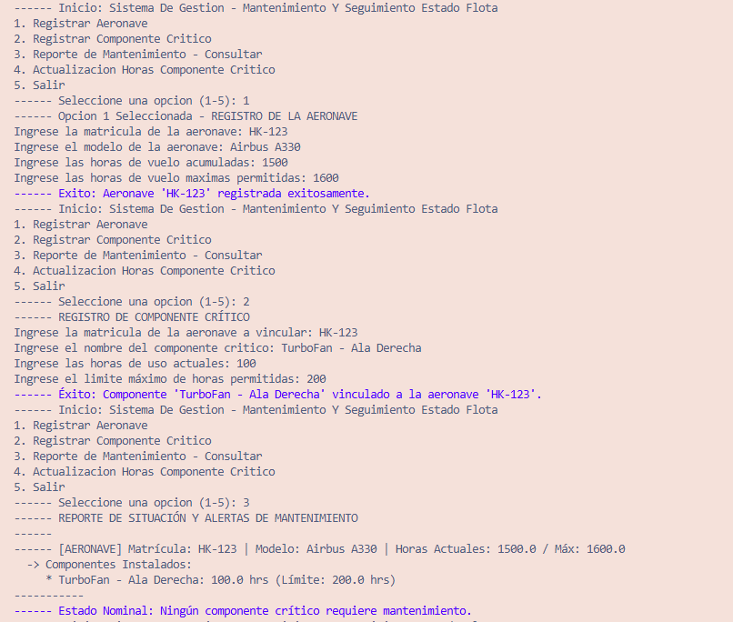
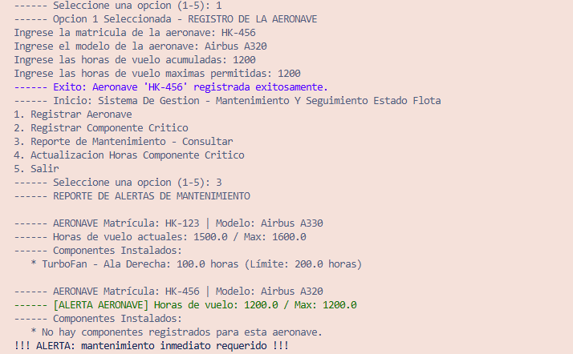
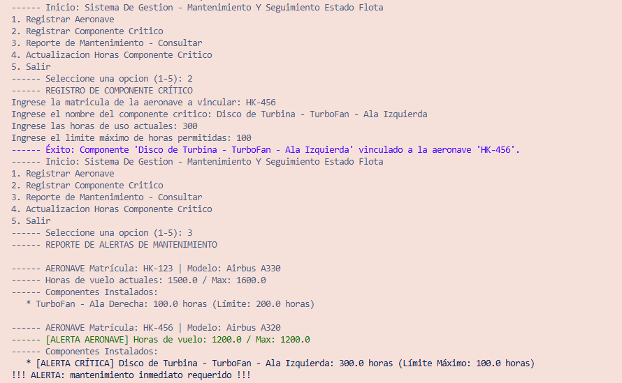
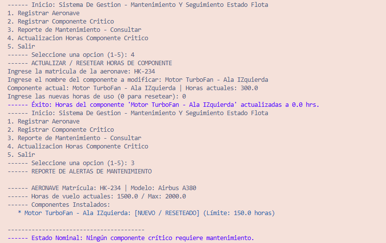

# Pruebas Realizacion del Reto Unidad 4

## 1. Registro de un avion 

## 2. Registro de Componente de la Aeronave

## 3. Partes del Codigo 

- Esta parte del codigo, nos muestra, como se introducen las horas de uso y las horas limites de la aeronave, y despues de registrar los componentes, lo almacena en la lista "matricula"  y el diccionario de matricula se almacena en el diccionario "diccionario_flota",  como con la matricula de la aeronave se identifica la aeronave que se requiere, la aeronave debe contar con un registro de:

1. el modelo 
2. horas de vuelo acomuladas 
3. horas maximas de vuelo permitidas

- En caso tal de que la matricula ya este registrada, no es necesario volver a ingresarlos nuevamente 

- En esta parte del codigo, se usa para registrar componentes criticos de la aeronave, usa el mismo formato que la anterior de donde se guardan sus datos, pero difiere en unas cosas bastante importantes:

1. Se identifica la eronave de la cual se registra su componente, permitiendo registrar componente dado al registro de la aeronave
2. se requieren de 3 datos para el registro del componente:
- 2.1 el nombre o numero de identificacion del componente
- 2.2 las horas de uso 
- 2.3 Horas limites 
3. El modelo tradicional vincula las horas de los componentes a las horas del avión, pero esto es un error operativo. Un componente puede instalarse antes o después de una revisión general, por lo que su desgaste real es independiente del total de la aeronave. Cada pieza debe llevar su propio contador de horas y un calendario de mantenimiento exclusivo

## 4. Reporte de Mantenimiento 

### 4.1 Reporte Estado Sin Alertas

- Se Añadio un nuevo Componente "turbofan - ala derecha", y se ingresaron sus horas de vuelo y sus horas permitidas, ya que las horas de vuelo son menores que las horas permitidas - por lo tanto no emite alertas 

### 4.2 Reporte Estado Alerta - Horas Vuelo Aeronave

- En esta parte, Al no ingresar El componente de la aeronave pero si la aeronave, podemos evidenciar que nos sale una alerta de error por limitew de horas de vuelo en el avion mas no en ningun componente

### 4.3 Reporte Alerta - Horas Uso Maximas COmponente 

- En este Caso se añadio un componente critico a la aeronave registrada anteriormente, en este caso, el componente critico excede las horas de vuelo permitidas emitiendo una alerta

# 5. Reiniciar Horas Uso Componente

## 5.1 Registro Componente Antes del Cambio De Horas

## 5.2 Registro COmponente Despues del Cambio de Horas

# 6. AutoEvaluacion

 1. Nota : 5.0 / 5.0 

 2. Justificacion : Consideramos que merecemos una calificación de 5.0 debido a que cumplimos rigurosamente en equipo con todos los requerimientos técnicos, lógicos y documentales exigidos en la guía. Desarrollamos un algoritmo robusto que mantiene una coherencia y simetría exacta entre el pseudocódigo, el diagrama de flujo y la implementación final en Python, estructurando la base de datos mediante diccionarios y listas anidadas en memoria RAM de forma óptima. Asimismo, blindamos el sistema con bloques de control de excepciones ante datos erróneos e integramos el módulo colors.py para garantizar una interfaz limpia, profesional y con alertas jerárquicas claras en la terminal. El factor diferencial y de mayor valor de nuestro trabajo radica en el diseño de la función para actualizar y resetear de manera independiente las horas de uso de los componentes críticos. Como demostramos detalladamente en nuestro reporte de pruebas, el sistema es capaz de rastrear con éxito escenarios nominales con piezas en cero horas ([NUEVO / RESETEADO]), así como disparar alertas críticas cuando un componente o el avión superan sus límites operativos. Esto valida de forma práctica nuestra hipótesis inicial: cada componente corre por un carril independiente al desgaste general del fuselaje, optimizando la trazabilidad real de la flota aeronáutica.