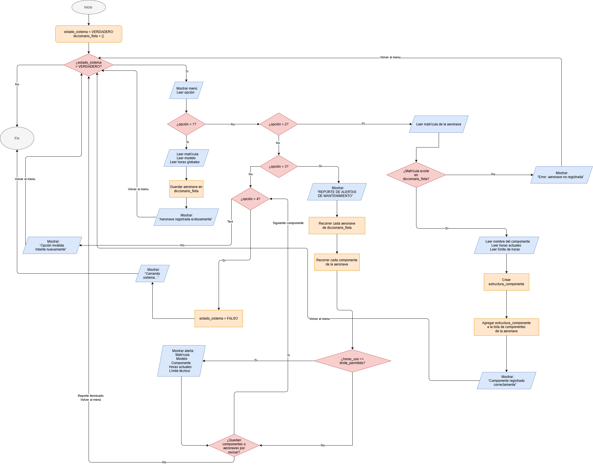

Presentacion del Archivo en fuente Markdown del Reto de la Unidad #4 

En el presente archivo se incluyen Analisis del problema, Pseudocodigo, Tabla de Datos y Diagrama de flujo

La idea de este Archivo sera demostrar o ejemplificar la realizacion del analisis hecho como base de demostracion de conceptos del reto de la unidad 4 

## Analisis del Problema 

1. Una Aerolinea regional requiere de un programa para la automatizacion de el control del desgaste tecnico de su flota para evitar fallas, identificando que componentes han superado el limite de operacion y requieren de mantenimiento preventivo o de ajuste inmediato 

el programa debe procesar ciertos datos que ingresa el usuario 

- a. Aeronave: cada entidad se debe identificar mediante su matricula, modelo y horas de vuelo acomuladas
- b. Componentes De Mayor importancia: cada aeronave registra componentes que deben de llevar un registro de horas permitidas antes del mantenimiento, y evidentemente para poder registrar eso se debe llevar un registro de horas de vuelo acumuladas

2. el programa requiere del uso de diccionarios y listas para poder vincular la aeronave con su grupo de componentes
3. el programa debe llevar un meno que permita registrar datos y luego, revisarlos para evaluar que la condicion de horas actuales sobrepase el limite permitido 
4. en las salidas del sistema se debe presentar una impresion en la consola que smuestre de manera explicita que aeronave y que componente superaron el umbral y requieren de intervencion 


## Pseudocodigo 
```
Inicio
 Hacer estado_sistema = "VERDADERO"

Hacer diccionario_flota = {}

Mientras estado_sistema == "VERDADERO" Hacer
     Escribir "--- SISTEMA DE GESTIÓN DE MANTENIMIENTO DE FLOTA ---"
     Escribir "1. Registrar Aeronave"
     Escribir "2. Registrar Componente Crítico"
     Escribir "3. Consultar Reporte de Mantenimiento"
    Escribir "4. Salir"
    Leer opcion

     Si opcion = 1 Entonces
        Escribir "Ingrese la matrícula de la aeronave:"
        Leer matricula

        Si matricula Existe en diccionario_flota Entonces
            Escribir "Error: La matrícula ya está registrada."
        Si no
            Escribir "Ingrese el modelo de la aeronave:"
            Leer modelo
            Escribir "Ingrese las horas de vuelo acumuladas:"
            Leer horas_globales

            Si horas_globales es un número Y horas_globales >= 0 Entonces
                Hacer diccionario_flota[matricula] = {"modelo": modelo, "horas": horas_globales, "componentes": []}
                Escribir "Aeronave registrada exitosamente."
            Si no
                Escribir "Error: Las horas deben ser un número mayor o igual a 0."
            Fin Si
        Fin Si

    Si no
        Si opcion = 2 Entonces
            Escribir "Ingrese la matrícula de la aeronave a asociar:"
            Leer matricula

            Si matricula Existe en diccionario_flota Entonces
                Escribir "Ingrese el nombre del componente crítico:"
                Leer nombre_componente
                Escribir "Ingrese las horas de uso actuales del componente:"
                Leer horas_actuales
                Escribir "Ingrese el límite de horas permitidas:"
                Leer limite_horas

                Si horas_actuales es un número Y horas_actuales >= 0 Y limite_horas es un número Y limite_horas > 0 Entonces
                    Hacer estructura_pieza = {"nombre": nombre_componente, "horas_uso": horas_actuales, "limite_horas": limite_horas}
                    Agregar estructura_pieza a diccionario_flota[matricula]["componentes"]
                    Escribir "Componente crítico registrado correctamente."
                Si no
                    Escribir "Error: Las horas y el límite deben ser números válidos."
                Fin Si
            Si no
                Escribir "Error: La aeronave no se encuentra registrada."
            Fin Si

        Si no
        Si opcion = 3 Entonces
            Escribir "=== REPORTE DE ALERTAS DE MANTENIMIENTO ==="
            Hacer indicador_alertas = "FALSO"
            Desde cada matricula en diccionario_flota Hacer
                Hacer datos_aeronave = diccionario_flota[matricula]
                Hacer lista_piezas = datos_aeronave["componentes"]

                Desde cada pieza en lista_piezas Hacer
                    Si pieza["horas_uso"] >= pieza["limite_horas"] Entonces
                        Hacer indicador_alertas = "VERDADERO"
                        Escribir "[ALERTA] Aeronave Matrícula:", matricula
                        Escribir "Modelo:", datos_aeronave["modelo"]
                        Escribir "Componente crítico afectado:", pieza["nombre"]
                        Escribir "Horas actuales:", pieza["horas_uso"]
                        Escribir "Límite técnico:", pieza["limite_horas"]
                        Escribir "----------------------------------------"
                    Fin Si
                Fin Desde
            Fin Desde

            Si indicador_alertas = "FALSO" Entonces
                Escribir "Ninguna pieza requiere mantenimiento."
            Fin Si

        Si no
            Si opcion = 4 Entonces
                Hacer estado_sistema = "FALSO"
                Escribir "Cerrando sistema..."
            Si no
                Escribir "Opción inválida. Intente de nuevo."
            Fin Si
        Fin Si
    Fin Si
    Fin Si

 Fin Mientras

 Fin

``` 

## Tabla de Variables 

| Nombre de la variable | Descripción | Tipo |
| :--- | :--- | :--- |
| `diccionario_flota` | Estructura principal en memoria RAM que almacena la flota completa mediante diccionarios y listas anidadas. | Diccionario (*Dict*) |
| `opcion_menu` | Valor numérico ingresado por teclado para controlar las opciones del menú principal. | Entero (*Int*) |
| `estado_sistema` | Bandera lógica de control que determina la continuidad del ciclo iterativo del menú principal (`while`). | Booleano (*Bool*) / Cadena |
| `var_matricula` | Identificador alfanumérico único de la aeronave (ej. HK-4532). | Cadena (*String*) |
| `var_modelo` | Designación del modelo técnico de la aeronave (ej. A320, ATR72). | Cadena (*String*) |
| `var_horas_globales` | Acumulado total de horas de operación de vuelo de la aeronave. | Real (*Float*) |
| `var_nombre_componente` | Identificación descriptiva de la pieza crítica sometida a revisión (ej. Motor izquierdo). | Cadena (*String*) |
| `var_horas_actuales` | Horas de uso actuales registradas en el componente crítico. | Real (*Float*) |
| `var_limite_horas` | Umbral técnico máximo de horas permitidas antes de requerir mantenimiento obligatorio. | Real (*Float*) |
| `estructura_componente` | Diccionario temporal que encapsula los atributos del componente antes de ingresarlo a la lista anidada. | Diccionario |
| `indicador_alertas` | Bandera auxiliar para registrar si el recorrido de auditoría detectó componentes en estado crítico. | Booleano / Cadena |

## Diagrama de Flujo 


